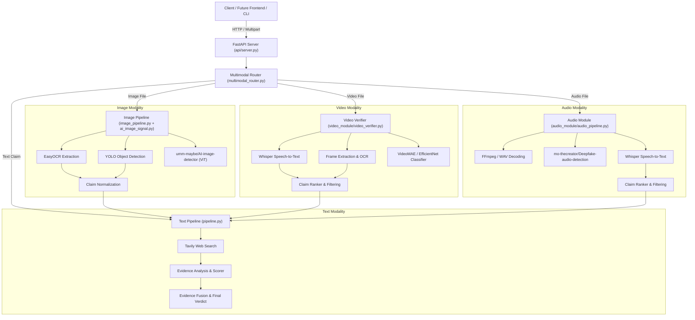

# TruthLensAI — Multimodal Backend Architecture & Integration Guide

## 1. Executive Summary & Design Principles

TruthLensAI is a multi-agent, multimodal misinformation detection and verification platform. It integrates four distinct media pipelines—**Text**, **Image**, **Video**, and **Audio**—into a single, high-performance API backend.

### Core Architectural Guarantees

1. **Strict Signal Separation**:
   - **Factual Veracity** (determined by web evidence collection, NLI, source reliability, and fusion logic) is strictly decoupled from **Media Provenance** (AI-generated synthetic media detection) and **Visual Classification** (experimental frame-level classification).
   - An AI-generated deepfake voice reciting verified facts will yield: `synthetic_media_detection.signal = "AI_GENERATED"` while `factual_verification.verdict = "REAL"`.
   - A real human voice reciting fabricated falsehoods will yield: `synthetic_media_detection.signal = "REAL"` while `factual_verification.verdict = "FAKE"`.
   - The signals are reported side-by-side; provenance never automatically overrides factual evidence.

2. **Zero Modification to Working Pipelines**:
   - The existing modules (`pipeline.py`, `image_pipeline.py`, `ai_image_signal.py`, `video_module/`, `audio_module/`) keep producing the same results.
   - All integration logic is housed in a clean orchestration wrapper (`multimodal_router.py`) and exposed via a RESTful API (`api/server.py`).
   - The only additions inside the existing modules are (a) the retrieval diagnostics that the API needs in order to report real research activity (`search_plans`, `search_errors`, `scrape_failures` in `pipeline.py`) and (b) a read-only report projection (`research_report.py`) that consumes the pipeline state without re-running anything.

3. **Graceful Degradation**:
   - If a heavy sub-detector fails (e.g. GPU out of memory, missing checkpoint, or corrupted audio/video codec), the system catches the error, sets that component's state to `UNAVAILABLE`, logs diagnostics, and returns the remaining evidence without crashing the server.

4. **One Consistent Evidence Policy**:
   - The deterministic gate (`final_verdict.deterministic_gate`) is the single place where the evidence policy lives, and it is **symmetric**: support and contradiction are judged by exactly the same rules.
   - A settled verdict requires **at least 2 independent publishers**, including **at least 1 primary publisher whose article text was actually retrieved**. "Primary" means a real publisher tier (`official`, `established_wire`, `major_outlet`, `regional/general_news`) - **not** merely "we managed to scrape the page". A blog post we scraped is still not primary reporting.
   - **Search snippets can never establish or refute a claim.** A snippet-only source is downgraded to related context in the fusion layer, exactly as the evidence analyzer already does.
   - **MISLEADING** additionally requires an **explicit, evidence-backed correction of a material claim detail** from a primary publisher. Generic disagreement is not enough.
   - An agent's confidence or agreement can only ever *narrow* the permitted set, never widen it.
   - Source identity is the **canonical URL** (campaign parameters and `www.`/`m.` prefixes normalised, article-selecting query parameters kept). A missing or reused `source_id` can never merge two different articles. A record whose publisher identity cannot be established is preserved for diagnostics but **excluded from the independent publisher counts**.
   - `UNVERIFIED` means *the evidence did not settle the claim*. It never means the claim is false. When the verdict is `UNVERIFIED`, `confidence` reports **verification coverage** (the share of the retrieved material that could actually be read), and `confidence_basis` says so.

---

## 2. System Architecture



---

## 3. Standardized Response Contract

All verification endpoints return a unified response schema adhering to the following structure:

```json
{
  "modality": "text | image | video | audio",
  "status": "success | error",
  "factual_verification": {
    "verdict": "REAL | FAKE | MISLEADING | UNVERIFIED | INCONCLUSIVE | null",
    "confidence": 0.95,
    "evidence_sufficiency": "SUFFICIENT | INSUFFICIENT | null",
    "independent_supporting": 3,
    "independent_contradicting": 0,
    "contradiction_score": 0.05,
    "source_agreement": 0.92,
    "fusion_score": 0.94
  },
  "synthetic_media_detection": {
    "signal": "AI_GENERATED | REAL | UNCERTAIN | UNAVAILABLE | null",
    "confidence": 0.98,
    "model": "mo-thecreator/Deepfake-audio-detection",
    "available": true,
    "warning": null,
    "probabilities": {
      "probability_synthetic": 0.98,
      "probability_real": 0.02
    },
    "error": null
  },
  "visual_classification": {
    "predicted_label": "fake | real | null",
    "confidence": 0.72,
    "experimental_warning": "Visual classifier is experimental.",
    "available": true,
    "probabilities": {
      "fake": 0.72,
      "real": 0.28
    }
  },
  "transcription": "Extracted spoken text...",
  "primary_claim": "The verified claim statement...",
  "consistency_analysis": {
    "status": "synthetic_contradicted",
    "description": "Multi-signal synthesis summary..."
  },
  "research_report": {
    "modality": "text",
    "executive_summary": {
      "input_claim": "The claim under investigation",
      "verdict": "UNVERIFIED",
      "confidence": 0.7,
      "confidence_basis": "Deterministic confidence computed by the evidence gate...",
      "attempted": "The system issued 4 search queries, retrieved 10 source(s)...",
      "key_findings": ["..."],
      "why_this_verdict": "Retrieved sources provide related context only...",
      "agent_narrative": "The verification agent's own explanation...",
      "critic_review": "The critic agent's own recommendation...",
      "limitations": ["No retrieved source directly addressed the claim..."]
    },
    "findings": {
      "supporting": [],
      "contradicting": [],
      "contextual": [],
      "unresolved": []
    },
    "claims": [
      {
        "claim_text": "...",
        "verdict": "UNVERIFIED",
        "confidence": 0.7,
        "reasoning": "...",
        "supporting_evidence": [],
        "contradicting_evidence": []
      }
    ],
    "methodology": {
      "research_skipped": false,
      "research_skipped_reason": null,
      "search_queries": [{ "label": "exact_claim", "query": "...", "intent": "exact" }],
      "search_errors": [],
      "sources_retrieved": 10,
      "articles_scraped": 9,
      "scrapes_failed": [{ "url": "...", "reason": "SCRAPE_FAILED: HTTP 403..." }],
      "evidence_passages": 26,
      "nli_evaluated": 26,
      "stages": [{ "name": "Query planning & web search", "status": "completed", "detail": "4 search queries issued" }]
    },
    "evidence_gaps": [
      { "question": "Is the claim supported or refuted by retrieved reporting?", "status": "NOT_ESTABLISHED", "detail": "...", "what_would_help": "..." }
    ]
  },
  "raw": { "...original uncompressed module output..." },
  "error": null,
  "warnings": []
}
```

### 3.1 The `research_report` block

`research_report` is built **server-side** by `research_report.py` directly from the
pipeline state that the backend already produced. It is a projection of real
results, not a second analysis: no source, URL, score, quote or conclusion appears
in it that the evidence engine, the source ledger, the retrieval diagnostics or the
agents did not record.

| Field | What it contains |
|---|---|
| `executive_summary.attempted` | The real search/scrape/NLI counts for this run |
| `executive_summary.key_findings` | Counts of supporting / contradicting / contextual passages, grouped by independent source group |
| `executive_summary.why_this_verdict` | The deterministic evidence gate's own reason string |
| `executive_summary.agent_narrative` | The verification agent's "Final Explanation", quoted verbatim |
| `executive_summary.critic_review` | The critic agent's "Final Recommendation", quoted verbatim |
| `executive_summary.limitations` | Uncertainties derived from the real counters (e.g. one corroborating publisher, failed scrapes) |
| `findings.*` | One entry per classified evidence passage: title, explanation, source name, clickable URL, verbatim excerpt, reliability, tier, NLI label/score, date check, event match, evidence strength |
| `claims` | One entry per adjudicated claim, with its own verdict, reasoning and source links |
| `methodology` | Real retrieval diagnostics: the queries issued, sources retained, articles scraped, failed retrievals with their real reasons, search errors, passage and NLI counts, and the per-stage trace |
| `evidence_gaps` | Unresolved questions, each with the reason it could not be closed and what evidence would help |

When research could not run (for example a video whose transcript yielded no
verifiable claim), `methodology.research_skipped` is `true` and
`methodology.research_skipped_reason` explains why in the pipeline's own terms. The
report then contains no findings at all, rather than a fabricated summary.

#### 3.1.1 Policy accounting

`research_report.executive_summary.policy_diagnostics` reports the deterministic
gate's own evidence-accounting state:

```json
{
  "gate_ran": true,
  "policy_data_valid": true,
  "policy_data_errors": [],
  "verdict_restricted": false,
  "explanation": "The evidence policy counters were complete and well-formed, so the deterministic gate applied the full evidence policy."
}
```

- `gate_ran` is `false` when the gate never evaluated this result (a modality
  with no verifiable claim to research). The report then says so instead of
  claiming the policy was checked.
- `policy_data_valid` is `false` when a required policy counter was missing or
  malformed. The gate cannot apply its policy without them and abstains with
  `UNVERIFIED`; `policy_data_errors` names each unusable field.
- `verdict_restricted` is `true` in that case, and the explanation states
  plainly that the restriction is **an internal evidence-accounting issue, not
  proof that the claim is false**.

The same two counters are also exposed on `factual_verification`
(`policy_data_valid`, `policy_data_errors`) and in `raw.final_verdict`, so the
UI can surface them without reading the raw payload. All three are additive:
no pre-existing response field changed.

Provider error text is passed through `research_report.redact_sensitive()`
before it reaches the response, so account identifiers and keys in a
third-party error message are not exposed.

---

## 4. REST API Endpoints

### 1. `GET /health`
Returns server status and sub-module readiness without exposing secrets.
```json
{
  "status": "healthy",
  "service": "TruthLensAI Multimodal Verification Engine",
  "version": "1.0.0",
  "api_keys_configured": { "groq": true, "tavily": true },
  "modules": {
    "text": { "available": true, "description": "..." },
    "image": { "available": true, "description": "..." },
    "video": { "available": true, "description": "..." },
    "audio": { "available": true, "description": "..." }
  }
}
```

### 2. `POST /verify/text`
- **Body**: `{"claim": "string"}` (JSON)
- **Response**: Unified verification object for factual veracity.

### 3. `POST /verify/image`
- **Form Data**: `file` (Multipart image file: `.jpg`, `.jpeg`, `.png`, `.webp`, `.bmp`, `.tiff`)
- **Response**: Unified object containing OCR text, normalized claim, factual verdict, and AI-image origin signal.

### 4. `POST /verify/video`
- **Form Data**:
  - `file`: Multipart video file (`.mp4`, `.mov`, `.avi`, `.mkv`, `.webm`, etc.)
  - `enable_classifier`: `true | false` (default: `true`)
  - `verify_claims`: `true | false` (default: `true`)
  - `whisper_model`: `"base" | "small" | "tiny"` (default: `"base"`)
  - `skip_ocr`: `true | false` (default: `false`)
  - `max_claims_to_verify`: integer (default: `1`)
  - `classifier_family`: `"videomae" | "efficientnet"` (default: `"videomae"`)
- **Response**: Unified object containing transcription, visual classification heuristic, verified claims, and evidence verdict.

### 5. `POST /verify/audio`
- **Form Data**:
  - `file`: Multipart audio file (`.wav`, `.mp3`, `.m4a`, `.flac`, `.aac`, `.ogg`)
  - `verify_claims`: `true | false` (default: `true`)
  - `whisper_model`: `"base" | "small" | "tiny"` (default: `"base"`)
  - `max_claims_to_verify`: integer (default: `1`)
- **Response**: Unified object containing deepfake speech detection, Whisper transcription, extracted candidate claims, and optional factual verification.

### 6. `POST /verify` (Omni-Modal Dispatcher)
- Accepts either a media file (`file`) or a text query (`claim`). Automatically identifies the input modality and routes it to the correct pipeline.

---

## 5. Running the Application

### Starting the Server
```powershell
python -m uvicorn api.server:app --host 127.0.0.1 --port 8001
```
Interactive Swagger UI documentation is available at `http://127.0.0.1:8001/docs`.

The frontend is configured against port **8001** (`frontend/src/services/api.ts`
and `frontend/vite.config.ts`).

### Running All Tests
```powershell
python -m pytest tests/ video_module/tests/ audio_module/tests/ -q
```
```powershell
cd frontend && npm run build && npm run test
```

---

## 6. Verification & Test Results

The integration test suite verifies:
- Modality detection for all supported formats.
- Correct error handling on unsupported or corrupt files.
- Strict signal separation on Text, Image, Video, and Audio.
- Live inference validation on real audio samples.
- FastAPI endpoint schemas, error responses, and health reporting.
- The `research_report` contract: field presence, real-only content, no
  fabricated sources, and correct skip reporting.
- The video factual-claim filter: the real saved run still yields zero
  verifiable claims, real claims are still recovered, and filler, greetings,
  apologies and noise are still rejected.

**Current Test Status**: **241 passed** (Python) + **16 passed** (frontend)
- `tests/`: 95 passed (integration, research report, API contract, frontend type contract, evidence-pipeline audit)
- `test_evidence_engine.py`: 60 passed
- `video_module/tests/`: 60 passed
- `audio_module/tests/`: 26 passed
- `frontend/src/components/ResearchReportPanel.test.tsx`: 16 passed

`video_module/tests/test_ai_generated_detector.py` cannot be collected in this
environment because the optional `timm` dependency is not installed. It is
unrelated to the changes described here.

### Evidence-pipeline audit regression suite

`tests/test_evidence_pipeline_audit.py` covers the 18 required cases with
controlled fixtures (no network, no LLM). It locks in the repaired policy:
no evidence → UNVERIFIED; context-only → UNVERIFIED; snippet-only publishers
can neither establish nor refute; one supporting article is insufficient; two
independent primary publishers may permit REAL; two independent contradicting
primary publishers may permit FAKE; many chunks of one article = one vote;
syndicated copies = one independence group; missing or reused `source_id`
never merges unrelated sources; a source with conflicting chunks is resolved
deterministically; support and contradiction together → UNVERIFIED; alternate
location spellings match; a publication year that differs from the event year
is not direct evidence; MISLEADING needs a recorded correction; the evidence
brief reports zero, mixed and snippet-only states accurately; and no agent
confidence or agreement can override the deterministic gate.

### Live end-to-end validation

`scratch/e2e_all_modalities.py` performs one genuine request per modality
against a running server, and `scratch/e2e_sse.py` exercises both SSE
endpoints. `scratch/trace_real_evidence.py` traces a single real run through
every layer. Observed results:

| Modality | Input | Factual verdict | Research | Key detail |
|---|---|---|---|---|
| Text | Chandrayaan-3 launch claim | `REAL` (0.617, `evidence_strength`) | ran | 4 queries, 10 sources, 8 scraped, 2 scrape failures, 25 passages NLI-scored, 2 primary supporting publisher groups, 3 supporting findings |
| Image | AI-generated benchmark image | `INSUFFICIENT_VERIFIABLE_CLAIMS` | skipped, reason given | AI-origin signal `AI_GENERATED` 0.9518; manipulation `NOT_ASSESSED` |
| Audio | Marathi news sample | `UNVERIFIED` (0.75, `verification_coverage`) | ran | Whisper transcript, 1 claim extracted, 4 queries, 4 sources (1 snippet-only), 9 passages; 3 of 4 sources readable, so coverage 0.75 |
| Video | OpenSora synthetic clip | `INSUFFICIENT_VERIFIABLE_CLAIMS` | skipped, reason given | VideoMAE `fake` 0.6528 kept as a separate experimental signal |

The Text row is the direct result of the audit. The same claim, from the same
retrieved sources, previously produced `UNVERIFIED` with zero supporting
findings because the event matcher required a location match even though the
claim stated no location. See section 8.

---

## 7. Frontend Application (React + Vite + Tailwind CSS)

The application frontend is located in the `frontend/` directory and implements the Stitch-approved **Forest Intelligence** design system.

### Starting the Frontend
```powershell
cd frontend
npm install
npm run dev
```
Accessible at: `http://localhost:5173/`

### Frontend Features
- **Strict Two-Page Architecture**:
  1. **Home / Verify**: Multimodal intake for Text, Image, Video, and Audio with live progress tracking, strictly decoupled Factual Veracity vs Media Provenance dossiers, wire provenance ledgers, and the point-wise research report.
  2. **System Overview**: Interactive 5-level pipeline tree, expandable node inspector with code entry points, real benchmark cards, and operational boundary disclosures.
- **Backend Proxy**: Vite proxies `/verify` and `/health` requests to `http://127.0.0.1:8001`.


---

### 4.1 Month-precision date claims

A claim that names a month and a year but no day ("in July 1969") is a date
claim. The parser recognises it as a **month-precision** date
(`precision: "month"`, `day: None`), and the date comparison is
precision-aware:

- evidence naming the same month and year satisfies the claim (it is simply
  more specific: "July 20, 1969" satisfies "July 1969");
- evidence naming a **different** month of the same year contradicts it;
- evidence naming only the year stays at "same_year" and cannot support the
  claim, because the claimed month is unconfirmed.

Recognising the month also stops the month name from leaking into the claim's
location list. A claim that names no place is no longer held to a location
requirement, and the event matcher no longer falls into the incident-marker
branch that only disaster claims can satisfy.

This also corrects the query planner: the month is now used as a **date** in
search queries (`"July, 1969" nasa's apollo mission`) instead of as a place
(`July "nasa's apollo mission"`).

---

### 4.2 Multi-paragraph context windows

A publisher often states a claim across **adjacent** paragraphs. NASA's own
Apollo 11 page splits it: "Apollo 11 astronauts ... sit atop another Saturn V",
then "When the lunar module lands ... The Eagle has landed", then "Armstrong
is ready to plant the first human foot on another world". Read on its own,
each paragraph is NEUTRAL against "NASA's Apollo 11 mission landed humans on
the Moon in July 1969", so the evidence layer could never support the claim
even though the article states it plainly.

The analyzer therefore offers, in addition to the single paragraphs:

* **contiguous windows of adjacent paragraphs** of the same article, built
  around the strongest paragraphs and bounded by the NLI token budget
  (`MAX_WINDOW_CHUNKS_PER_SOURCE`). A window contains only text that is
  already in the article - nothing is invented.

A window may **support** a claim but may **not refute** one. The NLI model
reads a diluted premise unreliably (measured: a window about Apollo 8 was
labelled `contradiction/0.9951` although it contradicts nothing), and a
spurious contradiction is far more harmful than a missed one. Refutation
therefore still requires a single focused passage, so the deterministic
evidence floor is unchanged. The record carries `passage_kind`
(`"paragraph"` / `"window"`) so the origin of every passage is visible.

---

## 8. Evidence-Pipeline Audit (2026-10-20)

A targeted audit of the evidence pipeline found and repaired ten defects. The
diagnosis is in `scratch/evidence_audit_diagnosis.md`; the reproductions are
in `scratch/repro_evidence_defects.py` and
`scratch/repro_locationless_claim.py`.

### P0 - the deterministic gate is now consistent

`final_verdict.deterministic_gate` used to require primary reporting for
SUPPORT but applied **no article requirement at all** to CONTRADICTION, so two
search snippets from two publishers could refute a claim. The gate now applies
one symmetric policy to both directions, permits MISLEADING only when the
evidence contains an explicit correction of a material claim detail from a
primary publisher, and its `permitted_reason` states the actual requirement
instead of a generic sentence.

### P0 - source identity and independence

Sources were grouped by `source_id`, so records with a missing id all merged
into one publisher and a reused id merged different articles. Sources are now
keyed by the **canonical URL** (campaign parameters and `www.`/`m.`
prefixes normalised, article-selecting query parameters kept). A record whose
publisher identity cannot be established is preserved in
`unresolved_source_decisions` and excluded from the independent counts.

"Primary reporting" was previously inferred from "we scraped it", which let a
blog post count as a primary publisher. The fusion layer now uses the
tier-based `is_primary_source` that `source_reliability` already computes.
A snippet-only source can never be a decisive publisher.

### P1 - classification, brief, confidence and serialisation

- `evidence_analyzer.evaluate_event_match` required a location match even
  when the claim stated **no location**, so a location-less claim could never
  reach `event_match='strong'` and therefore could never be SUPPORT. This
  was a genuine false negative, found by a live trace, and is repaired.
- `evidence_brief.build_evidence_brief` now reports the real state (sources
  retrieved, scraped, snippet-only, independent publishers, each
  classification count, unresolved identities, the evidence state - absent /
  inaccessible / inconclusive / contested - and the specific unmet
  requirements) and agrees with the gate by calling the gate itself.
- `calculate_final_confidence` no longer returns a high heuristic constant
  for UNVERIFIED. The number is now the **verification coverage**, labelled
  through the new `confidence_basis` field, and the UI shows
  "Evidence Coverage" instead of "Verdict Confidence" for that case.
- `_primary_evidence` selected passages by the *verdict*, so an UNVERIFIED
  verdict reported contradiction passages as supporting evidence. The two lists
  are now selected by class.
- `extract_verdict` no longer falls back to a bare label anywhere in the
  prose, so an incidental "not REAL to say ..." can no longer change a verdict.
